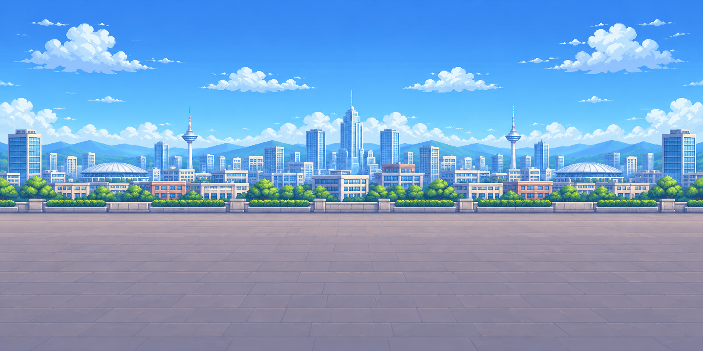
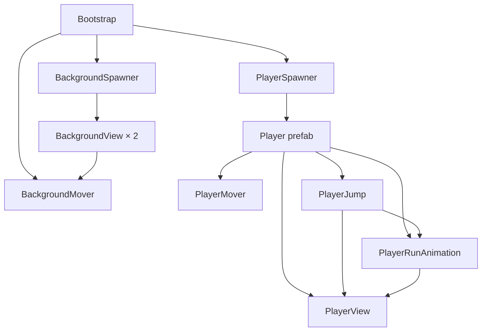
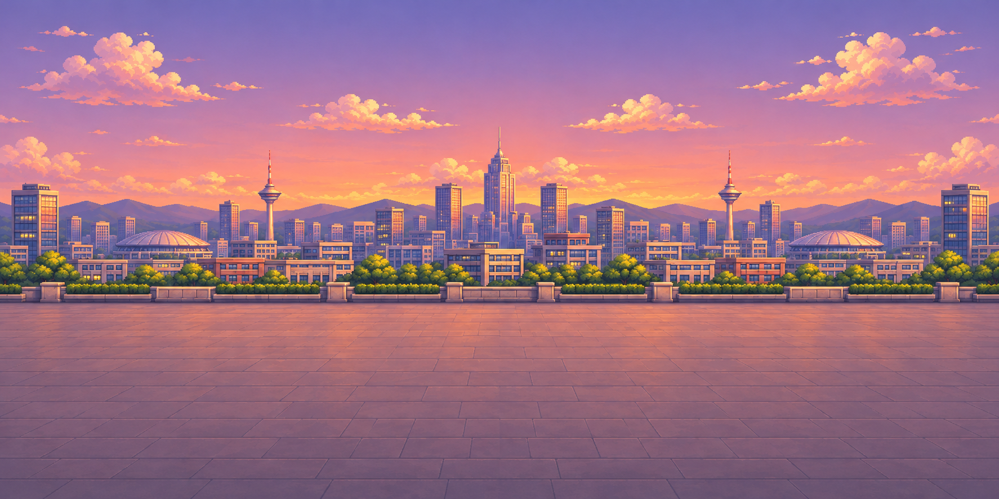
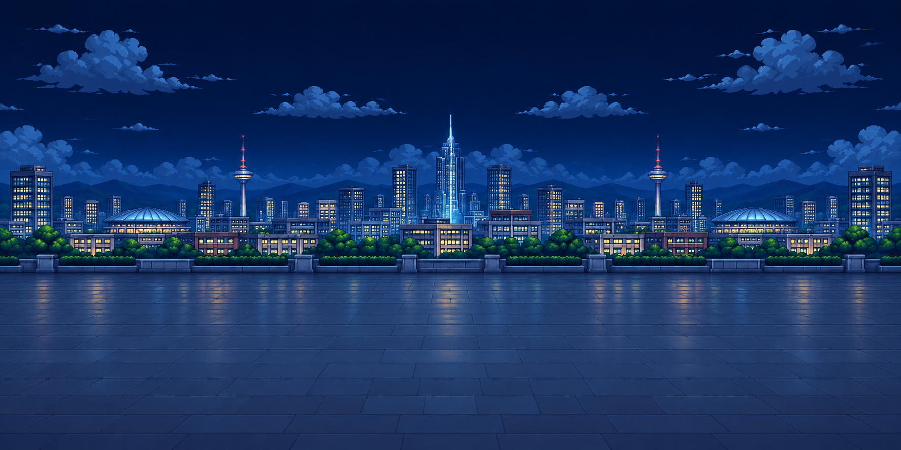

# 🦖 MoorkisDino2D


A 2D dinosaur runner prototype built with Unity and C#, inspired by the classic endless runner genre. The project focuses on responsive movement, sprite animation, continuous background scrolling and a component-based gameplay architecture.



*Daytime environment artwork from the project.*

## 🎮 Gameplay

The dinosaur enters the scene automatically and runs while the environment scrolls continuously. Press **Space** to jump; the running animation switches to a dedicated jump sprite and resumes on landing.

| Input | Action |
| :--- | :--- |
| `Space` | Jump |
| No input | Automatic running and background scrolling |

### Implemented features

- Automatic character movement into the running position.
- Frame-by-frame sprite animation.
- Jump mechanics with manually calculated vertical velocity and gravity.
- Continuous background scrolling using two recycled, mirrored background instances.
- Prefab-based player and background spawning.
- Separate components for movement, animation, spawning and visual presentation.

## 🛠️ Tech stack

| Technology | Role |
| :--- | :--- |
| **Unity 2022.3.62f3 LTS** | Game engine and editor |
| **C#** | Gameplay logic |
| **Unity UI (uGUI)** | UI-based sprite rendering with `Image` and `RectTransform` |
| **Unity 2D** | 2D asset and sprite workflow |
| **Git & GitHub** | Version control |

## 🧩 Architecture

The project uses small, focused `MonoBehaviour` components rather than placing the entire gameplay loop in a single script. `Bootstrap` initializes the scene, while the player and background components handle their own behavior.



| Component | Responsibility |
| :--- | :--- |
| `Bootstrap` | Initializes background instances and spawns the player |
| `PlayerSpawner` | Instantiates the player prefab |
| `PlayerMover` | Moves the player to its running position |
| `PlayerJump` | Handles jump input, vertical motion and landing |
| `PlayerRunAnimation` | Advances through running sprite frames |
| `PlayerView` | Displays the current sprite |
| `BackgroundSpawner` | Instantiates daytime background prefabs |
| `BackgroundMover` | Scrolls and recycles the background instances |
| `BackgroundView` | Represents a background prefab instance |

## 📁 Project structure

```text
MoorkisDino2D/
├── Assets/
│   ├── ArtAssets/          # Sprites and environment artwork
│   ├── Prefabs/            # Player and background prefabs
│   ├── Scenes/
│   │   └── SampleScene.unity
│   └── Scripts/
│       ├── Background/
│       │   ├── BackgroundMover.cs
│       │   ├── BackgroundSpawner.cs
│       │   └── BackgroundView.cs
│       ├── Player/
│       │   ├── PlayerJump.cs
│       │   ├── PlayerMover.cs
│       │   ├── PlayerRunAnimation.cs
│       │   ├── PlayerSpawner.cs
│       │   └── PlayerView.cs
│       └── Bootstrap.cs
├── Packages/               # Unity package dependencies
├── ProjectSettings/        # Engine configuration
└── README.md
```

## 🌄 Environments

The repository includes artwork and prefabs for three different times of day. The current prototype initializes the daytime environment; evening and night artwork is available for future integration.

| Day | Evening | Night |
| :---: | :---: | :---: |
|  |  |  |

## 🚀 Getting started

**Requirements:** Git, Unity Hub and Unity **2022.3.62f3** (the editor version used by this project).

1. Clone the repository:

   ```bash
   git clone https://github.com/epbloger/MoorkisDino2D.git
   ```

2. Open **Unity Hub**, select **Add project from disk**, and choose the cloned `MoorkisDino2D` folder.
3. Open the project with Unity 2022.3.62f3 and allow Unity to import the assets and restore its packages.
4. Open `Assets/Scenes/SampleScene.unity`.
5. Click **Play** in the Unity Editor and press **Space** to jump.

## 🗺️ Development status

MoorkisDino2D is currently a work-in-progress prototype. Core movement and animation are implemented; a complete runner gameplay loop is not yet present.

Possible next milestones:

- [ ] Obstacle spawning (cactus and flying obstacles)
- [ ] Collision detection and game-over logic
- [ ] Score and high-score system
- [ ] Progressive difficulty
- [ ] Day, evening and night transitions
- [ ] Restart flow and gameplay UI
- [ ] Sound effects and music

---

Developed by [**epbloger**](https://github.com/epbloger).

If you find the project interesting, consider leaving a ⭐ on the repository.
